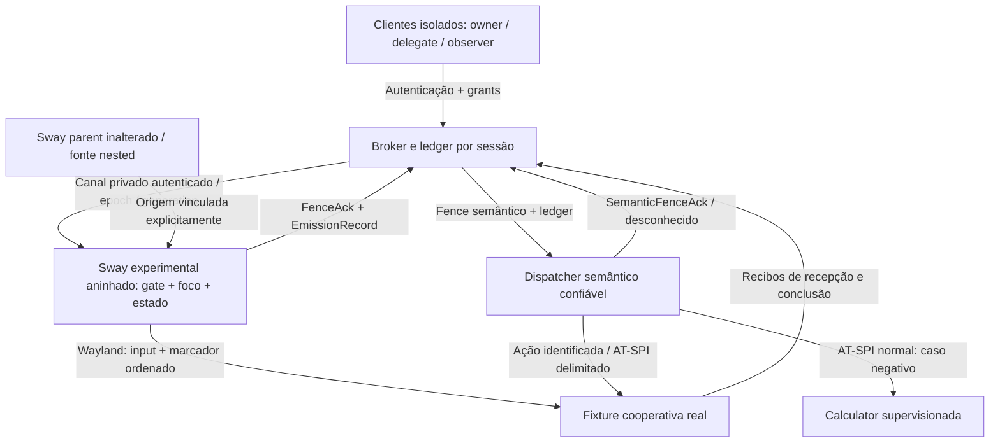
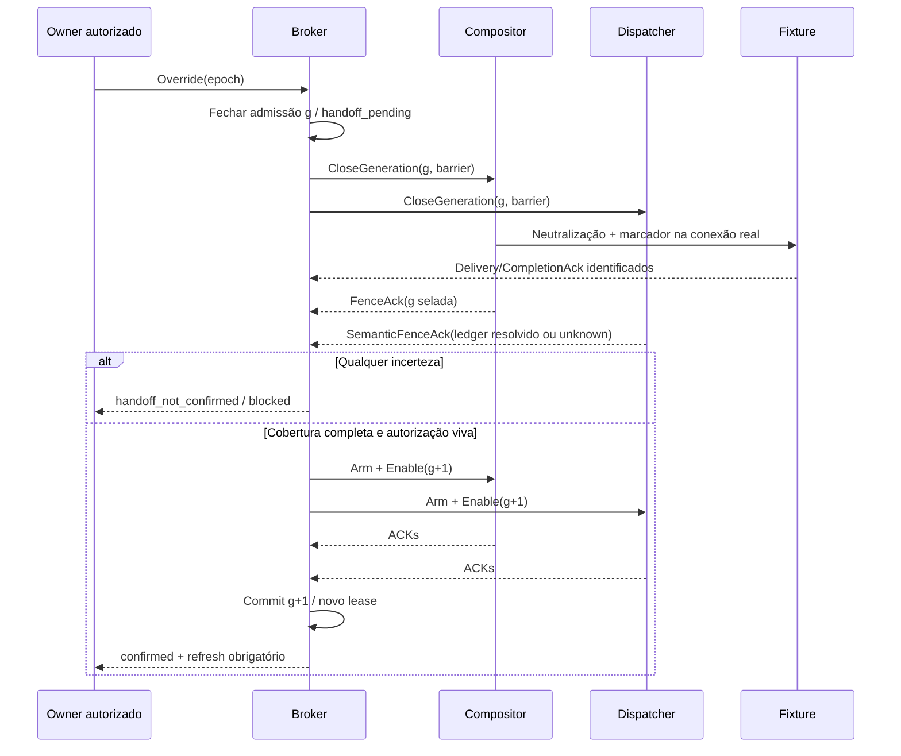

# M1.3B.1 — Delivery & Acknowledgement Contract

**Estado em 2026-11-16:** especificação candidata e análise de viabilidade;
nenhum patch, build, compositor aninhado ou takeover executado nesta entrega.
**Conclusão:** existe caminho tecnicamente plausível e delimitado para testar a
barreira conjunta em bancada aninhada **com receptor cooperativo e falha fechada**.
Isso não qualifica takeover em aplicações arbitrárias, binding de hardware do
parent, M1.3B completo, M1.3C ou produto. Recomenda-se revisar este contrato antes
de autorizar dependências e a futura POC M1.3B.2.

## 1. Base e decisões preservadas

Base de integração: `4d28d1c` (`main`, PR #8). Foram revisados README, VISION,
PRODUCT_DEFINITION, OPERATOR_MODEL, LOOPTEACH, ARCHITECTURE, LOOPBRIDGE,
SECURITY_MODEL, ROADMAP, índice e ADRs, em especial
[0006](../DECISIONS/0006-mandatory-agent-mediation.md),
[0007](../DECISIONS/0007-unified-input-mediation.md),
[0008](../DECISIONS/0008-operator-neutral-authority.md) e
[0009](../DECISIONS/0009-native-loopteach.md), além de
[Session Authority V1](SESSION_AUTHORITY_V1.md),
[M1.3A](../labs/M1_3A_SESSION_AUTHORITY.md) e
[M1.3B](../labs/M1_3B_TRUSTED_INPUT_FEASIBILITY.md).

Continuam aceitos: autenticação de principais, grants separados, mediação
obrigatória, takeover explicitamente autorizado e enforcement distribuído.
LoopTeach permanece planejado; anotação não autoriza nem confirma ação. Transporte,
compositor, protocolo de aplicação e stack do produto continuam abertos. Este
contrato refina obrigações experimentais sem mudar decisão aceita; uma adoção de
stack ou relaxamento da garantia exigiria ADR próprio.

M1.3A demonstra autoridade/arbitragem delimitadas; seus testes de takeover são
simulação. M1.3B encontrou **NO-GO na composição Sway sem patch + M1.3A**:
`doAction` expirou, houve revogação e desconexão, e depois apareceu `7` na
Calculator. O broker continuou `blocked`, geração 1, sem confirmar handoff.
A evidência não identifica o instante de entrega D-Bus nem demonstra nova entrega
após um handoff confirmado. Ela demonstra que timeout/desconexão não cancelam a
mensagem já enviada em outra conexão.

## 2. Vocabulário e estados verificáveis

**Operação** é uma mutação admitida com identidade única e escopo imutável:
`(session_id, session_epoch, generation, op_id, principal, connection_binding,
lease_binding, policy_revision, target_lifetime, focus_revision, source_binding)`.
Campos de identidade derivam do servidor autenticado. Uma operação pode gerar
vários eventos; cada um recebe `event_index`. O ledger registra todos os filhos;
confirmar apenas o último evento não resolve os demais.

**Despacho** é a passagem irretratável do emissor para um transporte ou executor
externo. **Entrega** é a aceitação no receptor definido pelo contrato, que deve
ser nomeado no recibo. **Processamento** é a execução de seu handler. **Efeito** é
uma mudança observável, possivelmente assíncrona ou externa. São fatos diferentes.

| Estado | Definição / evidência mínima | Não permite concluir |
| --- | --- | --- |
| `Admitted` | Broker validou conexão, grant, lease, epoch e geração e reservou entrada no ledger sob serialização da sessão | Preparação ou entrega |
| `Prepared` | Alvo e comando resolvidos; nenhum envio mutante começou; referência continua sujeita a revalidação | Autorização futura ou foco estável |
| `Dispatched` | Registrada tentativa de transferência que já pode escapar ao controle local; marcar antes da chamada externa | Recepção, processamento ou efeito |
| `Delivered` | Recibo confiável do receptor nomeado, ligado à operação e ao destino/lifetime, prova aceitação antes do corte | Handler terminou ou efeitos cessaram |
| `Completed` | Recibo de conclusão segundo predicado explícito da operação, ou observação correlacionada suficiente para esse predicado | Quiescência universal ou reversibilidade |
| `CancelledBeforeDelivery` | Toda cópia e produtor foram cancelados sob fence, sem possibilidade de entrega; antes de despacho basta prova local exclusiva | Que timeout ou erro de transporte cancelou algo |
| `OutcomeUnknown` | Não há prova suficiente de entrega, cancelamento ou conclusão exigida; inclui falha/crash após início de despacho | Ausência de efeito ou permissão para repetir |

Fluxo normal: `Admitted → Prepared → Dispatched → Delivered → Completed`.
Cancelamento provado pode sair de Admitted/Prepared; após Dispatched só com
protocolo de cancelamento no receptor que prove não entrega. Delivered nunca vira
CancelledBeforeDelivery. Timeout pode levar de Dispatched ou Delivered a
OutcomeUnknown; preservar `delivery_evidence` e `completion_evidence` como fatos
separados e monotônicos. Recibo tardio válido pode resolver a incerteza, mas não
reativa lease nem remove `blocked` automaticamente. Rejeições antes da admissão
não criam operação; falha conhecida após entrega é resultado de conclusão com
status de erro, não cancelamento.

O estado resumido não substitui os fatos: `Completed` sem recibo de entrega pode
provar um efeito específico, mas não basta para fechar uma barreira de entrega
quando a correlação ou os demais filhos forem incertos. Timeout após entrega
conhecida deixa conclusão desconhecida; **a política conservadora desta POC ainda
bloqueia** até resolução do predicado declarado.

### 2.1 Receptores e força dos recibos

| Canal / observação | O que realmente prova | Uso no contrato |
| --- | --- | --- |
| Retorno do broker / IPC Sway | Pedido tratado naquele componente | Nunca recibo de app |
| Chamada `wlr_seat_*notify*`, marshaling Wayland, flush ou escrita no socket | Tentativa/enfileiramento/envio pelo compositor, sujeito a grabs/foco | `EmissionRecord`, não `Delivered` ao app |
| Wayland roundtrip de uma conexão | Ordenação naquela conexão | Não drena outras conexões nem AT-SPI |
| ACK da fixture no handler real Wayland, com marcador ordenado na mesma conexão do evento | Receptor consumiu o evento identificado antes do marcador | `Delivered`; conclusão/repetição precisam predicados adicionais |
| Retorno booleano AT-SPI `DoAction` | Resultado da invocação segundo toolkit/ação | Sem token/cancelamento/quiescência universais; não basta isoladamente |
| Texto `7` consultado independentemente na Calculator | Efeito delimitado observado | Não demonstra instante de entrega nem ausência de efeitos futuros |
| ACK cooperativo do app no handler semântico com op_id autenticado | Recepção/processamento da ação identificada | `Delivered` e, se predicado satisfeito, `Completed` |
| App arbitrário sem cooperação / timeout AT-SPI | Não existe recibo suficiente disponível | `OutcomeUnknown`, recusar confirmação |

Não redefinir o socket ou o compositor como “aplicação” para obter GO. Para input
Wayland convencional sem ACK cooperativo, um evento já emitido pode continuar na
fila do cliente: **não confirmar** handoff supondo entrega porque o servidor fez
flush. Mesmo no app cooperativo, efeitos assíncronos declarados precisam recibos
próprios se a operação exigir quiescência. Nenhum protocolo finito prova ausência
de todos os efeitos futuros de um aplicativo arbitrário.

## 3. Arquitetura candidata e modelo de confiança

TCB de bancada: kernel/isolation, launcher, broker, dispatcher, compositor
experimental, parent e receptor cooperativo apenas para seus recibos. Cliente
isolado é não confiável, mesmo com grant. Apps normais não são fonte confiável de
recibo autenticado por simples metadado AT-SPI. O ACK da fixture prova apenas seu
comportamento instrumentado; não cria garantia contra app malicioso ou
comprometimento da TCB.

Launcher cria socketpairs privados, verifica peer credentials e entrega um nonce
por FD privado aos processos supervisionados; peer UID sozinho não autentica
principal. `Hello` vincula nonce, papel, versão e instance_id ao processo esperado.
Nenhum cliente recebe endpoint de enforcement, nonce, FD Wayland/IPC/AT-SPI ou
barramento da bancada. O broker autentica os principais efêmeros como M1.3A e
traduz sua autoridade em comandos internos; compositor/dispatcher aceitam somente
esse emissor autenticado. Não confiar no principal escrito pelo cliente.

Binding de fonte: owner com autorização explícita registra
`source_binding_id → principal/session/epoch/seat/device_instance/expiry/revision`.
Compositor aplica a tabela no ingresso e imediatamente antes de cada envio;
revogação invalida a revisão. Identificador de hardware, nome, UID, foco e movimento
não são autenticação. Virtual keyboard/pointer exigem conexão do injetor confiável
vinculada pelo launcher; outros criadores são negados. Fonte desconhecida ou
recriada começa sem binding. Teclados agrupados não podem perder proveniência.

No backend Wayland, o parent normalmente agrega hardware: a bancada pode vincular
a **fonte nested** a um principal autorizado, não atribuir um teclado físico
individual por essa via. Entrada física manual via parent e input virtual terão
traços separados, mas binding/enforcement no hardware do parent continuam fora da
prova. Não usar `/dev/input` ou `/dev/uinput`, root ou alteração do seat principal
para contornar essa limitação.

## 4. Barreira conjunta

Identificadores: epoch imprevisível por ciclo de vida da sessão; generation
monotônica nessa epoch; `barrier_id` único por tentativa; `instance_id` muda a cada
processo de enforcement reiniciado. Contadores locais e relações de precedência
formam a prova; timestamps monotônicos servem para duração, não ordenação global.

### 4.1 Mensagens candidatas (não API pública)

Todos os envelopes internos incluem versão, session/epoch, instance_id do destino,
generation, policy/binding revision, sequência monotônica e request/barrier_id.
Recebedor recusa epoch, emissor, revisão ou sequência incompatível; deduplicação
retorna o mesmo recibo, nunca repete mutação. Payload divergente no mesmo ID é erro.

| Mensagem | Emissor → receptor | Conteúdo / obrigação |
| --- | --- | --- |
| `InstallPolicy/BindSource` | Broker → compositor/dispatcher | Lease/grants derivados, destinos e fontes permitidos; ACK de instalação antes de controle |
| `SubmitInput/SubmitSemantic` | Broker → executor | op_id, alvo/lifetime, revisão de foco, deadline e binding; revalidar antes de enviar |
| `CloseGeneration` | Broker → ambos | barrier_id, geração antiga, watermark do ledger e política fechada; parar novos produtores |
| `EmissionRecord` | Compositor → ledger | Evento filho, receptor/surface/lifetime, sequência de saída, decisão emit/drop; não ACK de app |
| `DeliveryAck/CompletionAck` | Receptor cooperativo → ledger | op_id/eventos ou watermark contíguo, receptor/lifetime, marcador, predicado e resultado |
| `FenceAck` | Compositor → broker | Geração selada, último envio, filas descartadas, fontes bloqueadas, held-state/foco, lacunas e rotas cobertas |
| `SemanticFenceAck` | Dispatcher → broker | Ledger fechado; lista exata de cancelados/entregues/concluídos/desconhecidos, sem worker ainda capaz de enviar |
| `ArmGeneration/ArmAck` | Broker ↔ ambos | Instala geração nova ainda sem ingresso habilitado; ligada ao barrier_id e resumos anteriores |
| `EnableGeneration/EnableAck` | Broker ↔ ambos | Ativação só após ambos armados; nenhum token novo antes dos ACKs |
| `ControlChanged` | Broker → novo cliente/event stream | Commit de geração/lease e revisão; resposta perdida exige snapshot, sem repetir override |

ACK só é válido se cobrir o **conjunto completo** de operações/eventos admitidos
até o watermark e a ausência de lacunas no ledger. Um high-watermark máximo sem
continuidade não é cobertura. Registros ausentes, overflow ou canal perdido dão
blocked. A lista de rotas habilitadas faz parte do recibo; rotas não instrumentadas
devem estar desabilitadas de maneira verificada.

### 4.2 Ordem obrigatória

1. Autenticar requester; verificar `session.override`, `desktop.control`, escopo,
   epoch e política vivos. Sob lock curto da sessão, passar a `handoff_pending`,
   invalidar lease antigo, fechar admissões antigas e tirar snapshot do ledger.
   Nenhuma chamada externa ocorre segurando esse lock. Preparações concorrentes
   voltam a revalidar e não podem despachar com autorização antiga.
2. Enviar CloseGeneration aos dois executores. Cada um serializa fence com o
   **ponto real de envio**, sela a geração e descarta fila que ainda controla.
   Dispatcher fecha sua fila e reserva Dispatched antes de qualquer chamada
   externa. A intenção pendente é registrada antes de liberar serialização;
   crash entre reserva e envio deixa desconhecido, nunca cancelado por suposição.
3. Compositor resolve estado e foco conforme seção 5, cancela produtores internos
   antigos e emite FenceAck. Ele mantém a geração antiga selada indefinidamente;
   reconexão não reabre a geração. Dispatcher devolve seu ledger resolvido ou
   desconhecido. Não esperar indefinidamente: prazo total candidato 5 s, limitado
   também por watchdog independente de 10 s do harness.
4. Reconciliar cada entrada: cancelamento provado antes de entrega, ou entrega
   provada antes do corte e conclusão exigida resolvida. Recibos cooperativos de
   drain incluem eventos de neutralização. Unknown, lacuna, mudança de instância,
   timeout ou falha levam a `blocked/handoff_not_confirmed`; não incrementar
   generation nem retornar lease. Timeout do solicitante não aborta silenciosamente
   o fence em andamento.
5. Somente com todos os recibos suficientes revalidar requester/grants e armar
   `g+1` nos dois executores. Eles continuam sem fontes habilitadas até Enable.
   Após EnableAck de ambos, commit sob serialização da sessão: geração `g+1`,
   novo lease vinculado à conexão, `controlled`, evento ordenado. Fontes físicas
   ficam fechadas até rebind explícito e estado neutro; input virtual exige token
   novo, que só é entregue após commit. Falha intermediária sela também a geração
   candidata, mantém blocked e exige reconciliação; não há rollback para `g`.
6. Novo controlador obtém snapshot/handles novos. Uma confirmação repetida usa o
   mesmo resultado autorizado; credenciais de lease não aparecem em logs.

**Invariante:** após resposta confirmed, nenhuma ação/evento antigo pode ser
novamente entregue ao receptor da sessão. Para cada operação antiga deve haver
prova de entrega anterior ao corte ou de impossibilidade de entrega futura.
Além disso, esta POC exige resolver o predicado de conclusão declarado. Isso é
mais conservador que apenas impedir novos envios pelo compositor.

Um app pode executar depois um timer, salvar arquivo ou enviar rede a partir de
uma ação já entregue. A garantia de entrega não desfaz nem impede esses efeitos.
O ACK de processamento não é prova genérica de quiescência. Se o requisito de uma
operação incluir efeitos assíncronos não confirmáveis, essa operação bloqueia o
handoff; não prometer controle exclusivo da atividade interna de apps Linux.

## 5. Teclas, botões, repetição e foco

Manter por fonte e receptor: estado físico observado, estado lógico entregue,
modifiers, locks, grab, repeat e último foco/lifetime. Ao fechar geração:

- Parar timers de bindings/repeat do compositor antes de novo callback; callbacks
  já prontos revalidam geração. Repetição de cliente também existe: só receptor
  cooperativo confirma que parou seu repeat ao consumir leave/release/drain.
- Releases sintéticos de neutralização só para press conhecido e no receptor
  original, com op_id de limpeza ligado à geração antiga, **antes do ACK**.
  Release de botão pode ativar clique/drag: é entrega com possível efeito, não
  cancelamento. Se não for seguro/confirmável, manter blocked.
- Impedir transferência de pressed keys por keyboard enter para o foco novo.
  Teclas/botões fisicamente mantidos ficam em quarentena até release real e nova
  ativação; não reetiquetar estado antigo como `g+1`. Resolver modifiers/locks
  explicitamente no XKB/lógico e no receptor, sem inferir neutralidade física.
- Congelar envios durante alteração de foco. Incrementar focus_revision no mesmo
  event loop que faz a última validação de alvo e o envio. Pedido com revisão
  anterior é rejeitado/cancelado se ainda não enviado; nunca retarget automático.
  Destruição da surface ou grab/input method inesperado invalida o recibo.
- Ao perder foco do parent, backend pode produzir releases ou reconstruir estado
  no enter. Tratar como fonte/binding a revalidar, sem autoridade herdada. Não
  adquirir lease ao receber enter, leave, movimento ou tecla.

Touch, tablet, gestos, input method, Xwayland, text injection, drag-and-drop,
clipboard e comandos de bindings não usados devem ser desabilitados na bancada
ou cobertos pelo gate. A inexistência de um dispositivo não prova que seu global
ou caminho de criação esteja fechado. Um caminho mutante habilitado sem cobertura
impede GO. Não habilitar captura ou LoopTeach nesta POC.

## 6. Bancada e pontos concretos de instrumentação

Preferência experimental: Sway **1.10.1** + wlroots **0.18.2**, já estudados, com
backend Wayland nested e patch local auditável. Fontes Debian e upstream não são
presumidos binariamente idênticos; registrar pacote, patches, hashes e opções.
Usar wlroots dev empacotado se compatível, evitando fork adicional. Build não
iniciado. Se exigir redesenho extenso ou nova stack, parar e revisar escopo.

Os pontos abaixo são candidatos de inspeção e gate, **não um patch validado**:

| Fonte versionada | Instrumentação proposta |
| --- | --- |
| [Sway keyboard.c 1.10.1](https://github.com/swaywm/sway/blob/1.10.1/sway/input/keyboard.c) | `handle_key_event`, `handle_modifier_event`, `handle_keyboard_repeat`, grupos e encaminhamento ao input method: proveniência, revalidação antes de bindings/notify, cancelamento de timers |
| [Sway seat.c 1.10.1](https://github.com/swaywm/sway/blob/1.10.1/sway/input/seat.c) | `seat_keyboard_notify_enter`, `seat_set_focus*`, `seat_pointer_notify_button`: revisão de foco, pressed-state, destinatário e serialização do corte |
| [Sway cursor.c 1.10.1](https://github.com/swaywm/sway/blob/1.10.1/sway/input/cursor.c) | `pointer_motion`, `dispatch_cursor_button`, `dispatch_cursor_axis`, frames e seatops: rastrear rota completa até recurso receptor, não apenas ingresso |
| [Sway input-manager.c 1.10.1](https://github.com/swaywm/sway/blob/1.10.1/sway/input/input-manager.c) | `handle_virtual_keyboard`, `handle_virtual_pointer` e criação de dispositivos: negar emissores não vinculados; preservar proveniência antes de grupos |
| [wlroots backend/wayland/seat.c 0.18.2](https://sources.debian.org/src/wlroots/0.18.2-3/backend/wayland/seat.c/) | Traçar key/enter/leave do parent, reconstrução e releases; não assumir identidade de hardware |
| wlroots seat e recursos Wayland | Auditar consumidores finais de notify/send, grabs e enfileiramento por recurso; EmissionRecord depois da decisão real de destinatário. Se Sway não expuser essa informação, pequeno hook local em wlroots será dependência de escopo a revisar |
| [Broker M1.3A](../../experiments/m1_3a/broker.py) e [adapter](../../experiments/m1_3a/adapter.py) | Futura variante experimental: ledger + fence fora da chamada bloqueante, reserva de despacho e revalidação; não basta envolver `doAction` num booleano |

O gate no ingresso impede efeitos internos indevidos; o gate no envio impede fila
ou callback antigo de escapar. O inventário por busca de todos os `notify/send`,
seatops, bindings e protocolos é gate de preflight da futura implementação.
Registrar logs dos pontos efetivos mais ACKs do receptor; logs antes de um helper
que pode redirecionar/drop não provam destino nem entrega.

Fronteira semântica é separada: compositor não vê AT-SPI/D-Bus. Dispatcher é o
único emissor de ações semânticas da bancada. Barramento privado, apps de teste
sem acesso à sessão principal e cliente sem acesso direto evitam bypass. Uma fila
D-Bus já enviada não é recolhida pelo compositor nem por desconectar o cliente.

### 6.1 Receptor positivo e caso negativo

Receptor positivo futuro: pequena app GTK/Wayland de teste com contador, teclado,
botão e segunda janela para corrida de foco. Canal privado do launcher autentica
recibos; extensão experimental Wayland emite marcador ordenado **na mesma conexão
da app** após os eventos. A extensão delimita batches com op_id/event_index,
destino/lifetime e contagem/tipos esperados, ordenados junto dos eventos normais;
a fixture usa uma única fila de dispatch e correlaciona seus handlers entre os
marcadores. Divergência de contagem, ordem ou destinatário invalida o ACK. Handler
real registra o consumo e responde ao marcador com ledger contíguo. Não usar sync do injetor como substituto.

Para semântica positiva, fixture recebe op_id pelo canal privado e o associa de
forma inequívoca à única ação AT-SPI em voo, registrando entrada no handler real,
resultado e ausência das tarefas assíncronas que ela própria criou. Associação
ambígua, segundo emissor, timeout ou app reiniciado invalidam recibo. O mecanismo
exato de hook GTK/AT-SPI deve ser revisado no preflight; se não puder ser pequeno e
inequívoco, usar endpoint cooperativo app-specific identificado como tal e marcar
a parte **AT-SPI positiva PARTIAL**. Não alegar que metadado externo torna AT-SPI
normal cancelável. Mock/contador no dispatcher não substitui esse handler real.

GNOME Calculator normal supervisionada permanece caso negativo obrigatório:
repetir parada limitada antes de DoAction, timeout, revogação, desconexão e
retomada, agora enquanto compositor também fecha geração. Observar efeito tardio
e recusa de confirmação; não promover consulta `7` a recibo universal. Caminho
positivo sem pendências pode incluir Calculator apenas se não houver qualquer
operação anterior sem prova suficiente.

## 7. Dependências, isolamento e recuperação

### 7.1 Inventário consultado, sem instalação

Em 2026-11-16, `shutil.which` confirmou `cc`, `sway`, `bwrap` e
`dbus-run-session`; não encontrou `pkg-config`, `meson`, `ninja` ou
`wayland-scanner`. `dpkg-query -W` confirmou Sway `1.10.1-2`; não retornou como
instalados os pacotes dev/protocolos da lista abaixo. O inventário histórico de
[M1.3B](../labs/M1_3B_TRUSTED_INPUT_FEASIBILITY.md) contém runtimes, não toolchain
suficiente. Não foi executado Meson configure, build, apt ou nested.

**Instalação exige autorização posterior**, com plano de pacotes/transitivos e
revisão prévia, nunca `apt build-dep` irrestrito:

| Finalidade | Dependências candidatas ausentes consultadas |
| --- | --- |
| Ferramentas | `pkg-config`/`pkgconf`, `meson`, `ninja-build`, scanner fornecido por `libwayland-bin` |
| Sway/wlroots dev | `libwlroots-0.18-dev`, `libwayland-dev`, `wayland-protocols`, `libjson-c-dev`, `libpcre2-dev`, `libxkbcommon-dev`, `libpixman-1-dev`, `libevdev-dev`, `libinput-dev`, `libdrm-dev` |
| Render/texto | `libcairo2-dev`, `libpango1.0-dev`, `libgdk-pixbuf-2.0-dev`, `libegl-dev`, `libgles-dev` (diretos ou transitivos conforme opções) |
| Fixture cooperativa GTK | `libgtk-4-dev`; dependências GI/AT-SPI dev adicionais somente se o hook escolhido exigir |

A ausência das ferramentas foi verificada por executável; não se presume que os
nomes de todos os pacotes de ferramentas foram consultados via dpkg. Lista dev é
candidata, não closure de dependências resolvida. Conferir constraints do
[Meson Sway 1.10.1](https://github.com/swaywm/sway/blob/1.10.1/meson.build):
wlroots 0.18, Wayland >=1.21, protocolos >=1.24, xkbcommon >=1.5 e Meson >=0.60.
Desabilitar manpages, tray, swaybar/background e Xwayland se opções permitirem;
`scdoc` foi consultado e está ausente, mas é evitável sem manpages. `libudev-dev`,
XCB e outros transitivos precisam resolução explícita antes de instalação. Não
adicionar libei/EIS, Weston, Cage ou portal como desvio desta bancada.

Mudanças locais futuras previstas: checkout/build em diretório temporário sem
`ninja install`; patch do gate/recibos do compositor, possível hook de destino em
wlroots sujeito a novo limite, variante do broker/dispatcher, fixture cooperativa,
harness e logs sanitizados. Preservar licenças MIT de Sway/wlroots e obrigações de
terceiros; código original do projeto Apache-2.0. Nada disso é implementado aqui.

### 7.2 Isolamento e reversão propostos

1. Preflight recusa adotar app existente. Cria diretório temporário exclusivo 0700,
   runtime/config/HOME efêmeros, sessão D-Bus e AT-SPI privados, ledger e pidfds dos
   próprios children. Não copiar credenciais ou ambiente integral da sessão.
2. Apenas compositor nested recebe FD/socket parent necessário ao backend Wayland;
   apps recebem só display nested e barramento privado. Nenhum socket IPC parent,
   DRM/input/uinput, clipboard compartilhado, serviço público ou FD herdado extra
   chega a clientes/apps. Confirmar private AT-SPI address, sem autoativação no bus
   principal. Configuração Sway temporária sem include/exec de configuração pessoal.
3. Iniciar nested explicitamente com backend Wayland, renderer compatível e saída
   limitada. Se pedir DRM/seat físico/permissão adicional, parar. Não alterar Sway
   principal, configuração persistente, serviços ou sessão do usuário.
4. Antes de input, sondar acesso direto no baseline confiável e nos clientes
   Bubblewrap antes/depois de grant, incluindo sockets abstratos, `/proc` e FDs.
   Se o isolamento do display/bus privado não puder ser demonstrado, NO-GO.
5. Encerrar apenas children identificados por pidfd; retomar app parada antes de
   terminar. Watchdog limitado nunca sinaliza processo por nome ou app do usuário.
   Encerrar apps, dispatcher, nested e buses, esperar saída, fechar FDs. Confirmar
   ausência de children e sockets ativos; preservar evidência sanitizada fora do
   runtime antes de remover somente diretório temporário criado pelo harness.
6. Reversão é parar a árvore experimental e descartar seu build/config temporário;
   não requer reiniciar/reconfigurar parent. Pacotes eventualmente autorizados
   teriam plano próprio de reversão aprovado; não executar remoção automática.

### 7.3 Bloqueio e recuperação

Perda do broker/canal de controle exige watchdog local em compositor e dispatcher:
fechar fontes e geração, sem fallback de input físico. Crash do compositor impede
novas ações; perda do parent/backend também bloqueia. Unknown persiste no ledger;
reconectar, alterar epoch só no broker ou dar override administrativo não o apaga.
Se o broker perder o ledger em um restart, não reconstruir cancelamento por
ausência de registros: fechar os executores sobreviventes e exigir teardown
verificado ou prova integral equivalente antes de nova sessão. Persistência de
produção não é implementada por este contrato. Na mesma sessão, apenas recibos tardios válidos e reconciliação completa permitem
uma **nova tentativa explícita e autorizada**; sem prova, permanecer blocked.

Última recuperação de bancada: destruir toda a sessão experimental, apps, buses,
filas e workers; verificar término de cada instância supervisionada, então criar
outra sessão com nova epoch/instance IDs e autenticação/lease novos. Isso abandona
a sessão anterior; não confirma seu takeover e não desfaz efeito externo.
Recusar reset lógico com o mesmo app/worker vivo. Se término/drain não puder ser
provado, parar sem reiniciar controle. Produção/recuperação de dados não é
resolvida por esse teardown descartável.

## 8. Matriz reproduzível e critérios prévios

**Protocolo futuro de execução:** todos os casos usam sessão descartável e IDs
novos. Interleavings controlados por latches no ponto real instrumentado, não
por sleeps probabilísticos. Prazo de handoff 5 s, watchdog 10 s; cada corrida
executada nos dois lados do corte, com 10 repetições por ordem. Espera de efeito
negativo também limitada e registrada; ausência visual sozinha não prova bloqueio.
Saturação/log gap aborta a rodada. Esta seção é plano: **zero cenários executados
nesta entrega**.

Evidência por rodada: hashes/build/options, instance IDs, pseudônimos de bindings,
epoch/generation/barrier/op IDs não secretos, sequências de admissão/preparação/
despacho/emissão/ACK/corte/commit, alvo/lifetime/focus revision, ledger completo,
recibos de ambos executores, observação independente da app e resultado esperado/
real. Redigir teclas/textos de usuário, caminhos privados e credenciais; usar só
valores artificiais da fixture. Um logger do broker ou mock não prova enforcement.

| Caso / interleaving reproduzível | Observações obrigatórias nas fronteiras reais | Resultado exigido |
| --- | --- | --- |
| Sem operação pendente | Ledger vazio, gates fechados nos dois executores, held-state neutro, ACKs e commit; enviar novo input/semântica na fixture | confirmed em g+1, dois caminhos novos funcionam, pacote antigo negado |
| Antiga Prepared, não Dispatched | Pausar worker real após preparar; takeover; soltar worker e tentar envio | CancelledBeforeDelivery provado, zero envio antigo nos executores/app; handoff pode confirmar |
| Semântica cooperativa em voo | Pausar handler real antes do ACK; fence; liberar e colher recibos identificados | Nunca confirmar antes dos ACKs; depois, ledger resolvido permite confirmed |
| AT-SPI enviada, conclusão desconhecida | Calculator própria parada via pidfd; DoAction real, timeout, override/revogação, desconexão, retomada; logs dispatcher/compositor e consulta nova | blocked, g inalterada, nenhum lease novo; efeito tardio permitido e registrado, sem retry |
| Tecla/botão mantido + repeat/modifier | Press no receptor; repetir no compositor e no cliente; fence antes/depois do timer, manter hardware/fonte pressionada, release posterior | Timers fechados, neutralização/drain ACK antes de confirmação; nenhuma tecla herdada em g+1; unknown mantém blocked |
| Foco concorrente | Duas surfaces reais; latch antes de última validação e antes do enter/notify; mudar foco/destruir alvo nos dois lados | Revisão serializada, destino antigo ou rejeição explícita; nenhuma entrega ao destino errado; sem reidentificar alvo por foco novo |
| Físico via parent versus virtual | Fonte nested autorizada manualmente; injetor confiável separado; fonte sem binding; trocar bindings durante fence | Ambos passam pelo gate nested; desconhecidos negados; não alegar binding individual de hardware parent; automação virtual não substitui rodada física |
| Cliente antigo desconectado | Desconectar antes do despacho e após despacho real, mantendo conexão AT-SPI do dispatcher | Antes: cancelamento provado; depois: preservar pendência/unknown. EOF não limpa ledger nem concede lease |
| Compositor falha/desconecta | Matar só child por pidfd antes de FenceAck, entre Arm e Enable, e após commit; cortar backend parent da bancada | blocked e fechamento semântico, nenhum sucesso sem ACKs; reinício não reutiliza instance/epoch/lease |
| Replay epoch/generation | Guardar envelope interno de teste e pedido antigo; reenviar após fence, reconexão e recriação da sessão | Rejeição em broker **e** executores, zero emissão/handler duplicado; dedup do mesmo ID não repete efeito |
| Acesso direto não confiável | Sondas antes/depois de auth/grant: Wayland nested/parent, IPC, buses AT-SPI/sessão, X11, input/uinput, abstratos, FDs herdados e endpoint interno; baseline conecta aos endpoints disponíveis | Isolamento real nega todos os bypasses; grant Bridge não abre sockets; tentativa forged de principal/binding não chega à app |
| ACK falso/perdido ou lacuna | Emissor não confiável tenta ACK; suprimir ACK legítimo, overflow ou reiniciar app entre evento e marcador | Recusar recibo inválido, deadline → blocked; sem inferir conclusão de flush/IPC/consulta textual |

**GO da futura POC delimitada:** todos os cenários obrigatórios concluídos com
traços reais completos, passes positivos em input Wayland **e** handler semântico
cooperativo, fechamento conjunto comprovado e todos os negativos permanecendo
bloqueados/negados conforme matriz. A rodada AT-SPI unknown **passa como teste de
recusa**, nunca como sucesso de takeover naquela sessão. GO é apenas da fixture
cooperativa + política negativa; não é GO M1.3B geral nem do binding no parent.

**PARTIAL:** coleta incompleta, build/backend ausente, rodada física não realizada,
recibo positivo AT-SPI substituído por app-specific ou apenas subconjunto de
rotas/cenários testado, sem violação observada. Declarar exatamente a lacuna;
nenhum takeover em cenário sem recibo suficiente pode ser chamado confirmed.

**NO-GO da candidata:** qualquer entrega antiga após confirmed, autoridade por
input físico/label, acesso direto de cliente, ACK falso aceito, geração nova com
unknown, rota habilitada sem gate, herança indevida de held-state/foco ou
recuperação que só troca flags/epoch deixando emissores antigos vivos. Parar no
primeiro contraexemplo; não ampliar stack para esconder falha. Recusa segura de
todos os positivos é NO-GO de viabilidade de takeover, embora preserve segurança.

## 9. Escopo exato recomendado para a próxima POC

Após revisão e autorização separada das instalações: **uma sessão Sway nested,
um seat lógico, teclado/ponteiro, um owner e um delegate isolados, uma fixture
cooperativa de duas janelas e uma Calculator negativa**, uma operação semântica
por vez, sem rede externa, captura, clipboard, LoopTeach ou mudanças no parent.
Entregar gate/fence de gerações, ledger conjunto, neutralização, protocolo mínimo
de marcador/recibos da fixture, timeouts/teardown e execução da matriz acima.
O objetivo demonstrável é um takeover confirmado com ambos os canais resolvidos
e uma recusa obrigatória após AT-SPI unknown real.

Preflight da implementação deve primeiro confirmar hooks finais de entrega,
cobertura das rotas desabilitadas, mecanismo de ACK cooperativo, barramento
privado e custo do patch. Se exigir mudança extensa de wlroots/GTK ou não houver
recibo inequívoco, interromper antes de integrar; registrar PARTIAL/NO-GO em vez
de iniciar M1.3C ou selecionar stack do produto. Não há autorização nesta entrega
para instalar ou implementar M1.3B.2.

Riscos abertos: cobertura de grabs/seatops e agrupamento, repetição local no app,
filas do parent, correlação AT-SPI, custos de manter patch experimental, crash entre
envio e registro, impossibilidade de quiescência de apps arbitrários e confiança
nos ACKs. Critério de tamanho: patch restrito às rotas/recibos listados; qualquer
nova família de protocolo, fork amplo ou nova dependência funcional exige revisão
de escopo, sem refatorar o produto.

Se a candidata falhar: continuam viáveis sessões independentes sem handoff,
revogação seguida de teardown verificável da sessão descartável, protocolo
cooperativo em apps selecionados ou avaliação separada de compositor/EIS com
cooperação real. Nenhuma alternativa dá, sozinha, cancelamento AT-SPI universal.
O NO-GO do Sway sem patch permanece preservado.

## 10. Verificação desta entrega

Entrega documental; não se executaram cenários da seção 8, build, instalação ou
injeção. Foram feitas leituras de fontes locais/versionadas upstream e inventário
read-only com Python (`shutil.which`) e `dpkg-query -W`, além de Git fetch/status/
log e atualização de main por fast-forward. A branch anterior de PR #8 foi
rebaseada sobre main (commit já integrado detectado pelo Git) e renomeada para
esta tarefa; nenhum histórico remoto foi removido. Apenas uma branch de trabalho
ativa e main como integração.

Validação documental: `git diff --check`, verificação por Python de destinos de
links relativos Markdown e revisão de terminologia, invariantes, estados e
consistência com Session Authority V1/ADRs. Nenhum resultado histórico foi
reescrito e nenhum teste de runtime foi alegado como executado nesta entrega.
