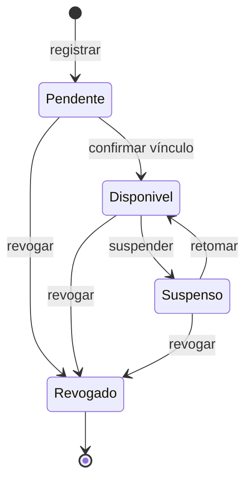
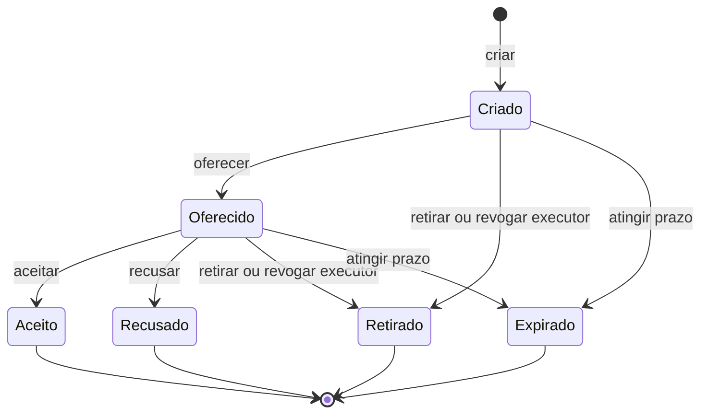

# V0.8-D.1A — Registro de executores e contratos de objetivos

**Protótipo local em memória.** A D.1A valida o contrato de domínio
proposto para registrar executores e entregar objetivos. O arbítrio de
sessão continua no LoopBridge. Os nomes abaixo descrevem o módulo
experimental e as propostas de integração.
[Proposta D.1](LOOPSHELL_V0_8_D1_PROPOSAL.md) ·
[Implementação experimental](../../experiments/objective_registry.py) ·
[Relatório de laboratório](../labs/LOOPSHELL_V0_8_D1A_OBJECTIVE_REGISTRY.md).

## Entidades e autoridade

| Entidade | Contrato |
| --- | --- |
| Principal | Identidade autenticada e sujeito dos escopos. O adaptador de confiança verifica a credencial e fornece o ID do sujeito ao domínio. |
| Executor | Registro identificado, rotulado e revisionado. Guarda o principal vinculado e o autor do registro. Pode receber ofertas após confirmar o vínculo. |
| Objetivo | Registro com ID, executor, emissor autenticado, texto, expiração, estado, revisão e autor da última alteração. A aceitação registra uma decisão de recebimento. |

O nome de apresentação e o conteúdo são dados. O domínio opera somente
sobre esses registros. O consumidor pode consultar as ofertas vigentes
com `list_offers` após autenticação, usando o ID do executor. A leitura
por ID e a consulta de ofertas entregam snapshots imutáveis.
[Modelo de operador](../OPERATOR_MODEL.md) ·
[ADR 0008](../DECISIONS/0008-operator-neutral-authority.md) ·
[ADR 0011](../DECISIONS/0011-session-presentation-and-operator-shell.md) ·
[ADR 0013](../DECISIONS/0013-loopshell-layout-and-mission-boundaries.md).

## Máquinas de estados

Suspender pausa a entrega e as respostas e preserva o prazo. Retomar
reabre as ofertas ainda vigentes. Revogar retira objetivos abertos
daquele executor na mesma seção crítica. Registros já vencidos são
expirados primeiro. Estados terminais conservam a revisão e autoria
registradas. O relógio monotônico é injetável. O prazo começa na
criação e a expiração é materializada na consulta ou mutação pertinente,
sem worker de fundo. O prazo já venceu quando `agora >= expiração`.

| Operação | Escopo experimental no executor exato | Regra adicional |
| --- | --- | --- |
| Registrar | `REGISTER` | O administrador nomeia o vínculo pendente. |
| Confirmar | `CONFIRM` | Somente o principal vinculado confirma. |
| Suspender, retomar, revogar | `MANAGE_EXECUTOR` | A revogação é terminal e encerra as ofertas e os rascunhos abertos. |
| Consultar executor | `READ_EXECUTOR` | O escopo permite somente leitura do registro. |
| Criar, oferecer, retirar | `AUTHOR_OBJECTIVE` | Oferecer e retirar exigem o emissor original. Criação e oferta exigem executor disponível. |
| Aceitar ou recusar | `RESPOND_TO_OBJECTIVE` | Exige oferta vigente e principal vinculado a executor disponível. |
| Consultar objetivo | `READ_OBJECTIVE` | Emissor original ou principal do executor disponível, com entrega prévia ao executor. |
| Listar ofertas | `READ_OBJECTIVE` | Somente o principal vinculado ao executor disponível. Retorna ofertas vigentes em ordem de criação. |

A autorização precede revisões, recibos e leitura de conteúdo. IDs
ausentes e registros fora do escopo retornam `denied`. O adaptador
`Authority.authenticate` deve manter identidade e política válidas
durante toda a operação, incluindo a escrita. O domínio mantém seu
próprio lock e adquire primeiro o contexto de autoridade. O adaptador
fornece o contexto e a decisão de escopo sem chamar o registro de volta.
Os escopos da tabela pertencem ao protótipo. A política de sessão, os
grants de workspace, mídia e entrada e as leases mantêm seus contratos.
As permissões do emissor são revalidadas a cada ação dele. Na D.1A,
retirar uma permissão do emissor impede novas ações desse emissor. O
destino das ofertas já publicadas em uma futura revogação de grant do
emissor precisa de decisão na integração.

## Revisões, idempotência e concorrência

Todos os registros começam na revisão 1. A mutação exige a revisão
atual e incrementa uma vez. A chave de idempotência é o ID da
solicitação no namespace do principal autenticado. Enquanto o
recibo existir e o ator continuar autorizado para aquela ação, uma
repetição idêntica devolve o recibo original imutável, com ID, revisão
e estado resultante. A consulta atual informa o estado corrente.
Reusar a chave com parâmetros diferentes retorna `request_conflict`.
A expiração ou retirada posterior podem tornar um recibo histórico
diferente do estado consultado. Solicitações negadas ou inválidas ficam
fora do cache. A assinatura de criação usa o hash do texto validado.
Em uma nova mutação autorizada, o prazo do objetivo é verificado antes
da revisão esperada.

Aceite e retirada com a mesma revisão formam uma disputa com apenas
um vencedor. Se a revogação do executor vencer a disputa contra um
aceite, a oferta é retirada e o aceite fica bloqueado. Se o aceite
vencer, o registro fica aceito e a revogação encerra a capacidade do
executor de responder ou consultar ofertas. Entre retirada explícita
e retirada derivada da revogação, só uma transição altera o objetivo.
A suíte testa ambas as ordens permitidas como resultados e verifica
que a revisão do objetivo avança uma vez.

## Limites do armazenamento experimental

IDs ASCII de 1 a 64 caracteres começam com letra ou dígito e aceitam
ponto, hífen e sublinhado. Nome de apresentação e texto têm limites
de 128 e 4.096 bytes UTF-8. O objetivo permite tab e LF. Os demais
controles C0/C1, texto em branco, texto não codificável em UTF-8 e TTL fora de
1 a 86.400 segundos são recusados. O texto aceito é preservado na
íntegra.

Cada instância guarda até 64 executores, 256 objetivos e 1.024
recibos bem-sucedidos. Registros terminais contam no limite. O
primeiro recibo é descartado quando entra um novo além do limite.
Após o descarte, IDs únicos e revisões ainda impedem reaplicar
uma mutação idêntica. A garantia de reconhecer conflito de chave
dura enquanto o recibo é retido. O encerramento do processo elimina
todos os registros. A sincronização cobre as threads de uma instância.
A credencial fica com o adaptador e o atendimento temporário da chamada.

## V0.8-D.1B — integração candidata para revisão

A prova durável e a revisão posterior destes candidatos estão no
[contrato D.1B](LOOPSHELL_V0_8_D1B_DURABLE_REGISTRY.md).

- **RPC.** Considerar `executor.register`, `executor.confirm`,
  `executor.status`, `executor.transition` com suspender, retomar e
  revogar tipados, `objective.create`, `objective.offer`,
  `objective.respond` com aceite e recusa tipados, `objective.withdraw`,
  `objective.status` e `objective.list_offers`. Definir schemas e a
  versão do protocolo, projeções, erros e limites de páginas antes da
  implementação.
- **Autenticação.** Aprovar provisionamento, confirmação de posse e
  rotação do principal individual. Ligar a decisão à identidade
  autenticada no ingresso mediado. UID, rótulo e papel declarado ficam
  como metadados para suas respectivas funções.
  [ADR 0012](../DECISIONS/0012-trusted-service-identity-boundary.md).
- **Grants.** Aprovar o namespace, escopos por executor, emissores,
  expiração e revogação. Especificar quais ofertas persistem quando
  autoridade do emissor é removida e como a revogação concorre com
  aceite e retirada. Definir a validação atômica de identidade, grant,
  revisão, prazo e gravação. As operações de sessão seguem mediadas
  pelas suas autorizações. [ADR 0007](../DECISIONS/0007-unified-input-mediation.md).
- **Persistência.** Escolher armazenamento controlado pelo serviço,
  transações de estado e recibo, migração, recuperação e expiração
  após reinício. Aprovar limites e retenção para registros, dados
  sensíveis, recusas e recibos.
- **Auditoria.** Definir autorização de leitura, evento, principal,
  IDs, revisão, instante e resultado. Manter tokens e texto do
  objetivo fora da projeção de auditoria. Ensaiar negativas e
  concorrência após reinício antes de qualificar o ingresso real.
